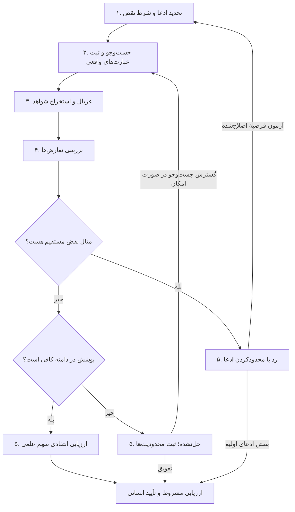

# راستی‌آزمایی شکاف پژوهشی

`WF-03` · Version 2.0.0 · 2026-10-31 · [English / فارسی](gap-verification.md)

## هدف و پیش‌نیازها

یک فرضیه شکاف را در برابر مجموعه‌ای شفاف و محدود از پیشینه بیازمایید. خروجی، ارزیابی مشروط است، نه اثبات اینکه هیچ‌کس موضوع را بررسی نکرده است. شکاف ممکن است به تفسیرهای ناسازگار، مرز آزموده‌نشده، سنجش ناکافی، منابع مغفول یا نیاز به تکرار مربوط باشد؛ نبود یک کلیدواژه رایج به‌خودی‌خود سهم علمی نیست.

پیش‌نیازها: پرسش اولیه، دسترسی به حداقل یک منبع جست‌وجوی علمی مرتبط و پژوهشگری که بتواند رکوردها را بررسی کند. دسترسی صرف به چکیده فقط داوری محدود را ممکن می‌کند. این گردش کار، پروتکل کامل مرور نظام‌مند نیست؛ برای ادعای پوشش نظام‌مند باید روش مرور متناسب با رشته را به‌کار ببرید.

## ورودی‌ها و وضعیت شواهد

ضروری: گزاره شکاف پیشنهادی، رشته، دامنه جست‌وجو و منابع شناخته‌شده؛ فهرست منابع می‌تواند خالی باشد. اختیاری: زبان‌ها، بازه زمانی، جغرافیا، طرح‌های مطالعه، قواعد ورود و خروج، مترادف‌ها، منابع آغازین و دفتر جست‌وجوی قبلی. `[GAP]` ادعای تحت بررسی است؛ `[SEARCH_SCOPE]` مرزهای جست‌وجو و `[RECORDS]` اسناد بازیابی‌شده همراه شناسه و وضعیت دسترسی هستند.

سه مرحله را جدا نگه دارید: **شکاف فرضی** پیش از بررسی؛ **مشاهده پشتیبانی‌شده با شواهد** مانند الگویی در مجموعه جست‌وجوشده؛ و **شکاف ارزیابی‌شده انتقادی** فقط پس از بررسی آثار مخالف، محدودیت‌های جست‌وجو و اهمیت علمی. هیچ مرحله‌ای به معنای تازگی قطعی در سراسر جهان نیست.

## نقشهٔ مراحل و تصمیم‌ها

گره‌های شماره‌دار هر پنج مرحله را نشان می‌دهند. جست‌وجوی محدود به ارزیابی مشروط کمک می‌کند؛ تازگی جهانی را ثابت نمی‌کند. تکرار جست‌وجو تابع دسترسی و ظرفیت پروژه است.

## فرایند و پرامپت هر مرحله

۱. **ادعا را ابطال‌پذیر کنید.** از [فرضیه شکاف](../prompts/gap-hypothesis.fa.md) استفاده کنید: «[GAP] را به پرسشی محدود بازنویسی کن و بگو چه یافته‌ای آن را نقض می‌کند. مترادف‌ها، اصطلاحات قدیمی‌تر، نظریه‌های مرتبط و رشته‌های مجاور را فهرست کن. نبود کلیدواژه را از نبود مفهوم جدا کن.» خروجی: ادعا، شرط نقض و بلوک‌های مفهومی جست‌وجو.

۲. **جست‌وجو و ثبت کنید.** «برای [SEARCH_SCOPE] عبارت‌های جست‌وجوی متناسب با هر پایگاه پیشنهاد بده و پوشش مورد انتظار را توضیح بده. ادعا نکن که آن‌ها را اجرا کرده‌ای. جست‌وجوی قوی‌ترین مثال نقض را هم بگنجان.» انسان یا ابزار مجاز جست‌وجو را اجرا می‌کند. نام واقعی پایگاه، عبارت دقیق، فیلتر، تاریخ، تعداد، محدودیت دسترسی و شناسه‌های خروجی را ثبت کنید. نحو عبارت‌ها را تطبیق دهید؛ یک عبارت را بدون تغییر در همه پایگاه‌ها تکرار نکنید. پایگاه‌ها و زبان‌های مرتبط با رشته و سپس جست‌وجوی ارجاعات پیشین و پسین منابع معتبر را بگنجانید.

۳. **غربال و استخراج کنید.** «رکوردهای [RECORDS] را طبق معیارهای ثبت‌شده با تصمیم ورود، خروج یا نامشخص و دلیل غربال کن. از منابع قابل دسترس، پرسش، بافت، مواد، طرح، یافته‌ها، محدودیت‌ها و نشانی محل شاهد را استخراج کن. گزارش منبع را از استنباط خودت جدا کن. مطالعه را صرفاً به دلیل مخالفت با [GAP] حذف نکن.» خروجی: دفتر غربال بدون تکرار و جدول شواهد. انسان تصمیم‌های مبهم و هویت منبع را بررسی می‌کند.

۴. **شکاف را به چالش بکشید.** از [تلفیق‌گر پیشینه](../prompts/literature-synthesizer.fa.md) استفاده کنید: «نزدیک‌ترین مطالعات و قوی‌ترین مثال‌های نقض [GAP] را مشخص کن. دامنه واقعی، تعریف‌ها و روش‌ها را مقایسه کن. آیا شکاف ظاهری ناشی از دسترسی، زبان، اصطلاحات یا پوشش پایگاه است؟ مواردی را که چکیده برای نتیجه‌گیری کافی نیست مشخص کن.» خروجی: جدول تعارض شامل ادعا، منبع، ارتباط و پیامد.

۵. **ارزیابی و تصمیم بگیرید.** از [منتقد موضوع](../prompts/topic-critic.fa.md) استفاده کنید: «[GAP] را در چارچوب جست‌وجوی مستند بسنج. یکی از پشتیبانی‌شده در دامنه، محدودشده، نقض‌شده یا حل‌نشده را انتخاب کن. اهمیت علمی را جدا از نبود شاهد توضیح بده. گزاره مشروط، محدودیت‌ها و جست‌وجو یا بررسی تخصصی بعدی را بنویس.» پیش از استفاده در پیشنهاد پژوهش، انسان آن را تأیید می‌کند.

## نقاط راستی‌آزمایی و مدیریت خطا

پیش از استناد، عنوان، نویسندگان، سال و شناسه را با رکورد ناشر یا پایگاه علمی تطبیق دهید؛ وجود شناسه، درستی ادعای متن را ثابت نمی‌کند. اگر نتیجه به متن کامل وابسته است، بخش مربوط را بخوانید. نسخه‌ها، اصلاحیه‌ها و پس‌گرفتن مقاله را در صورت مشاهده مشخص کنید. شکل‌های مختلف DOI و نسخه پیش‌چاپ و منتشرشده را بدون محو تفاوت نسخه‌ها مدیریت کنید. نبود متن کامل یعنی استخراج حل‌نشده، نه «هیچ مطالعه‌ای وجود ندارد».

اگر نتیجه صفر است، مترادف‌ها را گسترش دهید و فیلترهای محدودکننده را پیش از تفسیر نبود نتیجه حذف کنید. اگر نتایج بسیار زیادند، دامنه مفهومی را محدود و دلیل را ثبت کنید. در تعارض منابع، سازه‌ها و طرح‌ها را مقایسه کنید؛ اعتمادبه‌نفس مدل یا رأی اکثریت ملاک نیست. موارد حذف و یافته‌های مخالف را نگه دارید. تعداد دقیق، تاریخ جست‌وجو، DOI یا موفقیت دسترسی را نسازید.

## مثال انجام‌شده — تمرین جست‌وجوی ساختگی

فرضیه: «هیچ پژوهشی توضیح‌پذیری سامانه‌های زمان‌بندی در کارخانه‌های کوچک را بررسی نکرده است.» این تمرین سه **کارت ساختگی** دارد، نه استناد واقعی: S1 توضیح‌پذیری را در کارخانه بزرگ بررسی می‌کند؛ S2 زمان‌بندی تفسیرپذیر را در کارگاه کوچک بررسی می‌کند؛ S3 پذیرش AI در شرکت کوچک را بدون بحث زمان‌بندی بررسی می‌کند. نقشه مفهومی، «تفسیرپذیر»، «کارگاه» و «بنگاه کوچک و متوسط» را به عبارت اولیه می‌افزاید.

غربال، S1 را مجاور، S2 را مستقیم و S3 را زمینه‌ای تشخیص می‌دهد. S2 ادعای کلی «هیچ پژوهشی» را نقض می‌کند؛ S1 مرز مجاور را نشان می‌دهد و S3 به پرسش زمان‌بندی پاسخ نمی‌دهد. تصمیم: ادعای کلی نقض شده است. فرضیه اصلاح‌شده می‌تواند تفاوت نیاز توضیح میان نقش‌های کارگاه را بپرسد، اما آن هم فرضیه تأییدنشده جدیدی است و جست‌وجوی تازه می‌خواهد. گزاره نهایی مثال: «در این مجموعه ساختگی، یک مطالعه مستقیم ادعای نبود را رد می‌کند؛ این مجموعه وضعیت واقعی دانش را نشان نمی‌دهد.» جست‌وجوی واقعی پایگاه یا ارزیابی تجربی تازگی ادعا نشده است.

## قرارداد خروجی نهایی

پرونده ارزیابی شکاف ارائه کنید: ادعای اولیه و اصلاح‌شده؛ دامنه و شرط نقض؛ دفتر واقعی جست‌وجو؛ دفتر غربال و حذف؛ رکوردهای شاهد همراه محل و وضعیت؛ تحلیل تعارض؛ نتیجه و استدلال؛ دلیل سهم علمی؛ محدودیت پوشش، دسترسی و زبان؛ سؤال‌های حل‌نشده؛ و اقدام بعدی اعتبارسنجی. در حد مجاز قانونی، مسیر بازتولید جست‌وجو و خروجی‌ها را پیوست کنید. جمله کوتاه پیشنهاد پژوهش نیز باید مرزهای جست‌وجو را حفظ کند.

## ابزار اختیاری و سلامت پژوهش

جست‌وجو در نمایه‌های تخصصی و سرویس‌های کشف علمی می‌تواند دستی باشد. نرم‌افزار مدیریت منابع به حذف تکرار و دنبال‌کردن ارجاعات کمک می‌کند؛ API فراداده را صادر می‌کند، اما جای دسترسی متن کامل یا ارزیابی انتقادی را نمی‌گیرد. محدودیت واقعی هر پایگاه و API را ثبت کنید و پوشش جامع را القا نکنید. فقط از اسناد مجاز استفاده کنید، حقوق نشر را رعایت کنید، AI را طبق سیاست مربوط افشا کنید و گزاره مطمئن مدل درباره نبود پژوهش را شاهد ندانید. پس از محدودشدن شکاف به [اعتبارسنجی موضوع](topic-validation.fa.md) برگردید.
