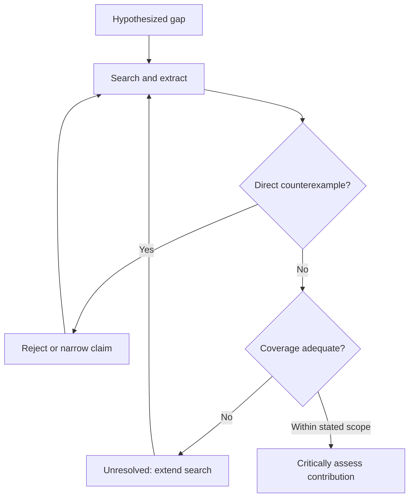

# Gap Verification

`WF-03` · Version 2.0.0 · 2026-10-31 · [English / فارسی](gap-verification.fa.md)

## Objective and prerequisites

Test a hypothesized gap against a transparent, bounded body of literature. The output is a qualified assessment, never proof that nobody has studied a question. A gap can concern conflicting interpretations, an untested boundary, inadequate measurement, neglected sources, or a replication need; absence of a fashionable keyword is not itself a contribution.

Prerequisites: a candidate question, access to at least one relevant scholarly search source, and a researcher able to inspect records. Access to abstracts alone supports only limited judgments. This is not a complete systematic-review protocol; adapt a discipline-appropriate review method when claiming systematic coverage.

## Inputs and evidence states

Required: proposed gap statement, field, search scope, and known sources (an empty list is allowed). Optional: languages, period, geography, study designs, inclusion/exclusion rules, synonyms, citation seeds, and prior search log. `[GAP]` is the claim under test; `[SEARCH_SCOPE]` defines these boundaries; `[RECORDS]` are retrieved documents with identifiers and access status.

Use three distinct stages: **hypothesized gap** before checking; **evidence-supported observation** such as a pattern within the searched corpus; **critically assessed gap** only after considering contrary work, search limitations, and scholarly significance. No stage means definitive global novelty.

## Decision map

A bounded search can support a qualified assessment; it cannot prove universal novelty.

## Process and stage prompts

1. **Make the claim falsifiable.** Use [Gap Hypothesis](../prompts/gap-hypothesis.md): “Rewrite [GAP] as a bounded question and state what finding would contradict it. List synonyms, older terminology, related theories, and adjacent fields. Separate an absent keyword from an absent concept.” Output: a claim, its disconfirmation condition, and search concept blocks.
2. **Search and log.** “For [SEARCH_SCOPE], propose database-specific queries and explain intended coverage. Do not say you ran them. Include a search for the strongest counterexample.” A human or authorized tool runs searches. Log actual database, exact query, filters, date, count, access limits, and exported identifiers. Adapt syntax; do not paste one query unchanged everywhere. Include relevant disciplinary databases and languages, then backward/forward citation searching from credible seeds.
3. **Screen and extract.** “Screen [RECORDS] using the recorded criteria. Give include/exclude/uncertain with a reason. From accessible sources extract question, context, materials, design, findings, limitations, and source locators. Separate reported content from your inference. Do not exclude a study merely because it contradicts [GAP].” Output: deduplicated screening register and evidence table. Human checks ambiguous decisions and source identity.
4. **Challenge the gap.** Use [Literature Synthesizer](../prompts/literature-synthesizer.md): “Identify the closest studies and strongest counterexamples to [GAP]. Compare their actual scope, definitions, and methods. Could the apparent gap reflect access, language, terminology, or database coverage? State where abstracts prevent a conclusion.” Output: contradiction table with claim, source, relevance, and consequence.
5. **Assess and decide.** Use [Topic Critic](../prompts/topic-critic.md): “Assess [GAP] within the documented search. Choose supported within scope, narrowed, contradicted, or unresolved. Explain scholarly significance separately from missing evidence. Give a qualified statement, limitations, and the next search or expert check.” Human signs off before using the assessment in a proposal.

## Verification checkpoints and error handling

Verify title/authors/year/identifier against the publisher or scholarly record before citation; an identifier's existence does not verify a claim. Read the relevant full-text passage when a conclusion depends on it. Distinguish versions, corrections, and retractions when observed. Deduplicate DOI variants and preprint/published versions without erasing version differences. Missing full text means unresolved extraction, not “no study exists.”

If a query yields zero results, broaden synonyms and remove restrictive filters before interpreting absence. If it yields too many, refine conceptual scope and record why. When sources disagree, compare constructs and designs rather than choosing by model confidence or majority vote. Preserve exclusions and contrary findings. Do not invent exact counts, search dates, DOIs, or access success.

## Worked example — synthetic search exercise

Hypothesis: “No research studies explainability of scheduling systems in small factories.” The exercise uses three **synthetic cards**, not real citations: S1 examines explainability in large factories; S2 examines interpretable scheduling in small workshops; S3 discusses small-firm AI adoption without scheduling. The concept map adds “interpretable,” “workshop,” and “SME” to the original wording.

Screening includes S1 as adjacent, S2 as direct, and S3 as contextual. S2 contradicts the broad “no research” claim; S1 shows a neighboring boundary and S3 does not answer the scheduling question. Decision: broad claim contradicted. A revised hypothesis might ask whether explanation needs vary by workshop role, but that is a new unverified hypothesis requiring another search. The final example statement is: “In this synthetic set, one direct study defeats the original absence claim; the set cannot establish the state of real scholarship.” No actual database search or empirical novelty evaluation is claimed.

## Final output contract

Deliver a gap-assessment dossier containing: original and revised claim; scope and disconfirmation condition; actual search log; screening/exclusion register; evidence records with source locators and status; contradiction analysis; outcome and justification; contribution rationale; coverage/access/language limitations; unresolved questions; and next validation action. Attach a reproducible search/export trail where licensing permits. A concise proposal sentence must retain the search boundaries.

## Optional tools and integrity

Search can be performed manually in disciplinary indexes and scholarly discovery services. Citation managers assist deduplication and citation chaining; APIs can export metadata but do not substitute for full-text access or critical appraisal. Record database-specific access and API limitations rather than implying comprehensive coverage. Use only authorized documents, preserve copyright restrictions, disclose AI assistance as required, and never treat an AI's confident absence statement as evidence. Continue to [Topic Validation](topic-validation.md) after the gap is narrowed.
