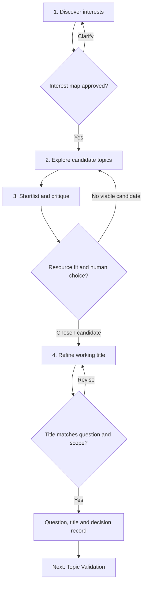

# Topic to Title

`WF-01` · Version 2.0.0 · 2026-10-31 · [English / فارسی](topic-to-title.fa.md)

## Objective and prerequisites

Turn an uncertain interest into a bounded research question and an honest working title. This is an ideation workflow; completing it does not establish novelty or supervisor approval. No code, API, paid service, or initial topic is required. Have a notebook or document to retain decisions and a rough understanding of the degree requirements. Beginners may write “unknown” for method and data.

## Inputs

Required: discipline or broad area, academic level, and the purpose of the work (thesis, article, or book). Optional: interests, disliked tasks, accessible materials, time, languages, methods, location, and institutional requirements. `[PROFILE]` means this brief personal research context; `[CANDIDATES]` means the resulting list, not published studies.

## Stages and decisions

Each numbered node matches a stage below. Approval and selection belong to the researcher; a working title still needs validation.

## Process and stage prompts

| Stage | Action and copyable prompt | Intermediate output and checkpoint |
|---|---|---|
| 1. Discover interests | Use [Interest Discovery](../prompts/interest-discovery.md). “From this profile: [PROFILE], ask at most three focused questions about problems I enjoy, materials I can access, and work I can sustain. Do not require a method choice. Summarize three interest directions and the assumptions behind each.” | Interest map with attraction, uncertainty, and constraints. User corrects the interpretation before topic generation. |
| 2. Explore topics | Choose [Thesis Brainstormer](../prompts/thesis-brainstormer.md), [Article Angle Explorer](../prompts/article-angle-explorer.md), or [Book Concept Explorer](../prompts/book-concept-explorer.md). For a real conceptual bridge use [Cross-Disciplinary Title](../prompts/cross-disciplinary-title.md). “Generate five candidates from the approved interest map. Use Balanced exploration. For each give problem, question, materials, possible contribution, and a concrete first check. Mark all novelty suggestions unverified.” | Five comparable candidate cards. Reject candidates dependent on inaccessible data before ranking. |
| 3. Shortlist | Use [Topic Critic](../prompts/topic-critic.md). “Compare [CANDIDATES] for relevance to my goal, scope, resource fit, and disciplinary contribution. Identify the strongest objection to each. Do not invent literature or average away a fatal access problem. Retain up to two and explain the trade-off.” | Two candidates or a request to change scope. Human chooses one; AI scores are discussion aids. |
| 4. Refine title | Use [Title Refiner](../prompts/title-refiner.md). “For the chosen question give three working titles: descriptive, method-aware if the method is decided, and concise. Explain every substantive wording change. Do not imply causation, effectiveness, superiority, or novelty beyond the proposed design and evidence.” | One working title plus alternatives, question, scope, and remaining validation tasks. |

The exploration mode requests a style of ideation; it does not set API sampling parameters.

## Decisions and error handling

If no initial interest exists, start with experiences, accessible texts, or recurring problems; do not force a niche. If all candidates fail resource constraints, return to stage 2 with a narrower corpus, secondary data, or a different question. If the topic combines disciplines only by name, require a shared object or defensible conceptual relationship. If a title promises an “impact” from descriptive data, revise the question or title. If the user cannot distinguish the two finalists, compare the first week of actual work for each rather than generating more titles.

## Worked example — illustrative, not an empirical result

Profile: Master's in IT management; interested in customer complaints; four months; public reviews may be available but collection permission is not confirmed; no private company database. Stage 1 produces interest in service friction, trust, and complaint handling. Stage 2 proposes, among others, a review-based taxonomy of service friction and a causal study of complaint handling and retention. Stage 3 rejects the causal study because the profile has neither intervention nor retention data. The retained question is: “How are service-friction themes expressed in a permission-cleared corpus of Persian online service reviews?”

Three working titles are “Service-Friction Themes in Persian Online Service Reviews,” “A Qualitative Content Analysis of Service Friction in Persian Online Reviews,” and “Mapping Service Friction in Persian Reviews.” The second is appropriate only if qualitative content analysis is selected and justified. The user chooses the first until the method is settled. First-week work: check platform terms and sampling feasibility, inspect 30 permission-cleared reviews, and consult a supervisor about question scope. No claim is made that this theme is absent from prior scholarship.

## Final output contract

Deliver a human-readable decision record with: chosen interest and rationale; working question and title; bounded population/corpus/context; proposed contribution marked unverified; accessible versus assumed resources; rejected alternative and reason; unresolved assumptions; and the next validation step. Carry this record into [Topic Validation](topic-validation.md); route any novelty claim to [Gap Verification](gap-verification.md).

## Optional implementation and integrity

Any chat interface can perform the stages. Keep the same approved profile across stages and save each version locally with date and prompt ID. Optional spreadsheets compare candidates; optional Zotero collections hold real sources later. Do not upload identifiable reviews, confidential proposals, or unpublished data without authorization. Record AI assistance according to applicable university/publisher policy. Human researchers own the question, methodological choices, citations, and final wording.
