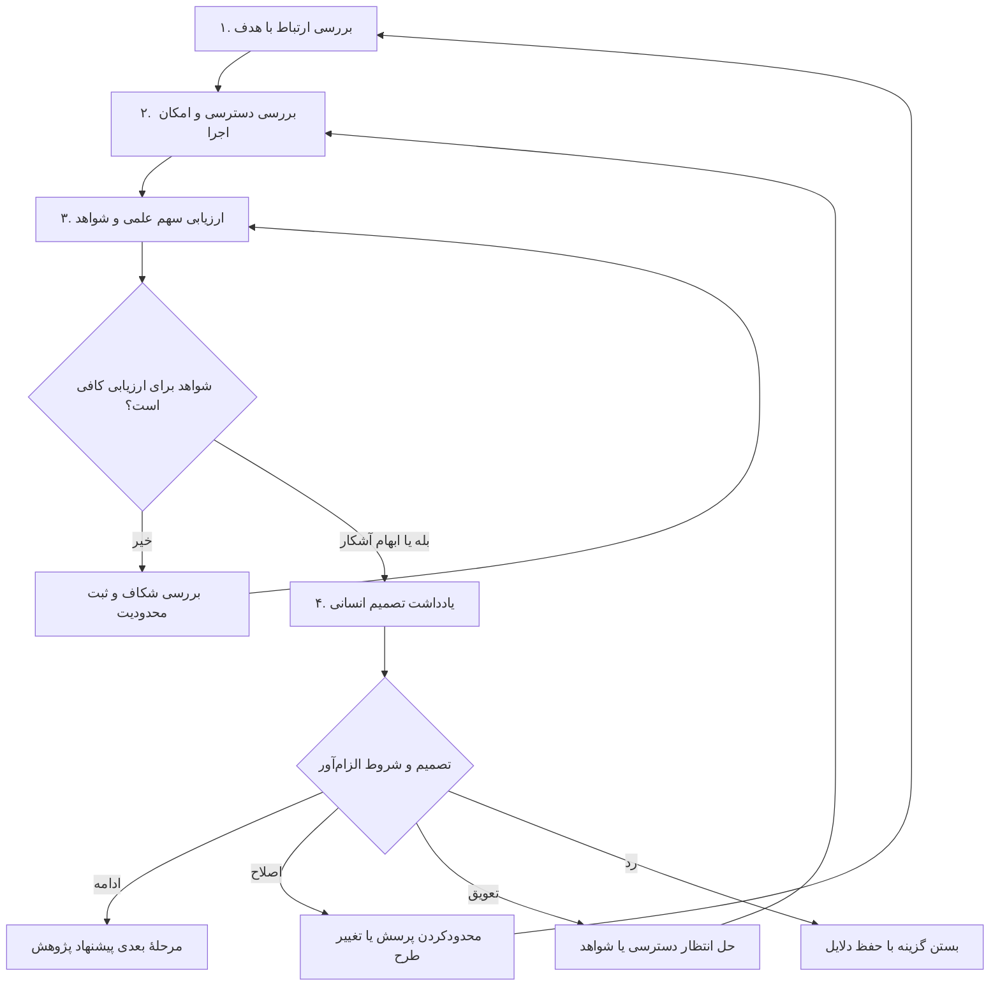

# اعتبارسنجی موضوع پژوهش

`WF-02` · Version 2.0.0 · 2026-10-31 · [English / فارسی](topic-validation.md)

## هدف و پیش‌نیازها

تصمیم بگیرید که موضوع برای ورود به مرحله پیشنهاد پژوهش مناسب است، به اصلاح نیاز دارد، باید به تعویق بیفتد یا کنار گذاشته شود. ارتباط با هدف، دسترسی عملی، تناسب روش و نوع سهم پیشنهادی را جداگانه بسنجید. موضوع جذاب ممکن است عملی نباشد؛ پژوهش تفسیری کم‌هزینه نیز ممکن است سهم مهمی داشته باشد. یک پرسش اولیه و آمادگی پژوهشگر برای بررسی ادعاهای دسترسی کافی است؛ استفاده از امتیازدهی عددی الزامی نیست.

## ورودی‌ها

ضروری: پرسش یا عنوان اولیه، رشته و خروجی دانشگاهی مورد نظر، مهلت شناخته‌شده و آنچه واقعاً در دسترس است. دسترسی نامشخص قابل ثبت است، اما تأییدشده محسوب نمی‌شود. اختیاری: مقررات مقطع، فهرست منابع، بودجه، مهارت‌ها، محدودیت اخلاقی، تجهیزات، توانایی زبانی و نظر استاد. `[TOPIC]` سابقه موضوع و `[CONSTRAINTS]` فهرست محدودیت‌های مشخص آن است.

## نقشهٔ مراحل و تصمیم‌ها

شواهد ناکافی می‌تواند به تعویق بینجامد؛ جست‌وجو نباید بی‌پایان شود. امتیاز مطلوب، مانع حیاتی مجوز یا ایمنی را رفع نمی‌کند.

## فرایند مرحله‌به‌مرحله

| مرحله | دستور قابل استفاده | خروجی و بررسی |
|---|---|---|
| ۱. ارتباط با هدف | «موضوع [TOPIC] را نسبت به هدف دانشگاهی و مخاطب آن بررسی کن. توضیح بده به مسئله چه کسی یا کدام پرسش تفسیری می‌پردازد. علاقه شخصی، اهمیت عملی و اهمیت علمی را جدا کن. اگر ابهام حیاتی وجود دارد، حداکثر سه سؤال بپرس.» | بیان ارتباط موضوع با هدف. پژوهشگر یا استاد تناسب چارچوب با رشته را بررسی می‌کند. |
| ۲. دسترسی و امکان اجرا | از [ارزیاب امکان‌پذیری](../prompts/feasibility-assessor.fa.md) استفاده کنید. «موضوع [TOPIC] را با محدودیت‌های [CONSTRAINTS] بسنج. منابع قطعی، فرض‌های تأییدنشده و نیازهای غیرقابل دسترس را جدا کن. حداقل مطالعه قابل اجرا، وابستگی‌ها، زمان‌بندی با حاشیه و شرایط توقف را ارائه بده. هرجا لازم است، تأیید اخلاق و مجوز را پیش‌نیاز بدان.» | دفتر منابع و ترتیب واقع‌بینانه کار. دسترسی را از متولی داده، آرشیو، آزمایشگاه یا مؤسسه بپرسید؛ گفته مدل تأیید دسترسی نیست. |
| ۳. سهم علمی | از [فرضیه شکاف](../prompts/gap-hypothesis.fa.md) فقط برای مسیرهای موقت استفاده کنید. «سهم پیشنهادی را بدون ادعای تازگی توضیح بده: تکرار، گسترش، تفسیر، روش، نظریه، تصحیح متن یا تلفیق؟ نزدیک‌ترین آثار را از میان منابع تأییدشده ورودی و قوی‌ترین نقد به این سهم مشخص کن. بررسی پیشینه باقی‌مانده را بنویس.» | فرضیه سهم و برنامه جست‌وجوی شواهد مخالف. در نبود منبع تأییدشده، شواهد را ناکافی بنامید و از [راستی‌آزمایی شکاف](gap-verification.fa.md) استفاده کنید. |
| ۴. تصمیم | از [منتقد موضوع](../prompts/topic-critic.fa.md) استفاده کنید. «برای [TOPIC] یادداشت تصمیم بنویس. یکی از ادامه، اصلاح، تعویق یا رد را انتخاب کن. محدودیت الزام‌آور را از ترجیح جدا کن. شرایط لازم و فرد مسئول بررسی هرکدام را مشخص کن. امتیاز میانگین بالا نباید مانع حیاتی مجوز یا ایمنی را پنهان کند.» | تصمیم مورد تأیید انسان و فهرست اقدام‌ها. اگر دامنه تغییر کرد، عنوان را با [اصلاح‌گر عنوان](../prompts/title-refiner.fa.md) به‌روز کنید. |

## قواعد تصمیم و مدیریت خطا

«ادامه» یعنی آمادگی ورود به مرحله بعدی پیشنهاد پژوهش، نه پذیرش تضمینی. وقتی دامنه محدودتر یا طرح دیگر مشکل را حل می‌کند، «اصلاح» کنید. اگر تصمیم، مجوز یا منبع ضروری در انتظار است، «تعویق» بدهید. اگر دسترسی اصلی ممکن نیست یا طرح به پرسش پاسخ نمی‌دهد، «رد» کنید. «فعلاً عملی نیست» را با «بی‌ارزش است» یکسان نگیرید.

اگر بودجه یا زمان مشخص نیست، بازه بخواهید و هزینه دقیق نسازید. اگر ادعای علّی پشتوانه طرح مناسب ندارد، پرسش توصیفی یا ارتباطی پیشنهاد کنید یا طرح قابل دفاع بخواهید. در پژوهش متنی، توانایی زبان اصلی و نسخه‌های معتبر را در وابستگی‌ها لحاظ کنید. در علوم زیستی، کار حساس تابع تأیید مؤسسه و نظارت فرد واجد صلاحیت است؛ مدل مجوز آزمایش صادر نمی‌کند.

## مثال انجام‌شده — سابقه تصمیم آموزشی

موضوع: «آیا داشبورد جدید کیفیت تصمیم را در یک شرکت تولیدی افزایش می‌دهد؟» پژوهشگر: دانشجوی ارشد مدیریت؛ دوازده هفته زمان؛ تنها دسترسی به لاگ استفاده بی‌نام تأیید شده؛ بدون دسترسی به پیامدهای کارکنان یا مجوز مداخله. ارتباط موضوع با هدف قابل تصور است، اما پیامد علّی پیشنهادی با منابع موجود مشاهده‌پذیر نیست. سهم علمی تأیید نشده، چون هنوز جست‌وجوی مستندی انجام نشده است.

تصمیم: اصلاح. پرسش پیشنهادی: «الگوهای استفاده از داشبورد در دوره مشاهده، میان واحدهای سازمانی دارای مجوز چگونه تفاوت دارند؟» حداقل مطالعه: فرهنگ داده و کنترل مجوز در هفته ۱؛ بررسی کامل‌بودن و شناسه‌ها در هفته ۲؛ تحلیل توصیفی و حساسیت به تعریف فعالیت در هفته‌های ۳ تا ۶؛ تفسیر با بررسی متخصص مجاز در هفته‌های ۷ تا ۸؛ نگارش و حاشیه زمانی در هفته‌های ۹ تا ۱۲. این نمونه برنامه‌ریزی است، نه زمان‌بندی اعتبارسنجی‌شده یا یافته واقعی شرکت. اگر بی‌نام‌سازی شکست بخورد یا مقایسه واحدها کارکنان را قابل شناسایی کند، توقف کنید. اقدامات بعد: تأیید مجوز تجمیع از متولی داده، جست‌وجوی پیشینه پذیرش داشبورد و پرسش از استاد درباره کفایت دامنه توصیفی برای مقطع.

## قرارداد خروجی نهایی

ارائه کنید: موضوع و پرسش اصلاح‌شده در صورت نیاز؛ دلیل ارتباط با هدف؛ نوع سهم و وضعیت شواهد؛ دفتر منابع و مجوزها همراه مسئول؛ تناسب طرح با پرسش؛ زمان‌بندی و حاشیه؛ خطرهای حیاتی و راه کاهش؛ تصمیم و شروط؛ ابهام‌های حل‌نشده؛ و اقدام بعدی راستی‌آزمایی همراه مسئول. مگر با توافق درباره معنای محلی امتیاز، امتیاز کل ندهید. در صورت امتیازدهی، ابعاد و شرایط توقف را نیز جدا نشان دهید.

## ابزار اختیاری و حفاظت از سلامت پژوهش

یک سند و چک‌لیست کافی است. صفحه‌گسترده می‌تواند وابستگی‌ها و مسئولان را ثبت کند و نرم‌افزار مدیریت منابع آثار نزدیک و تأییدشده را پیوست کند. در دسترس بودن ابزار، مجوز استفاده از داده نیست. بارگذاری را به حداقل برسانید، در صورت موجه‌بودن بی‌نام‌سازی کنید، مجوزها و محدودیت‌های آرشیوی را رعایت کنید و استفاده از AI را طبق سیاست مربوط افشا کنید. پژوهشگر امکان اجرا را با افراد مسئول بررسی و دلیل حذف گزینه‌ها را نگه می‌دارد.
