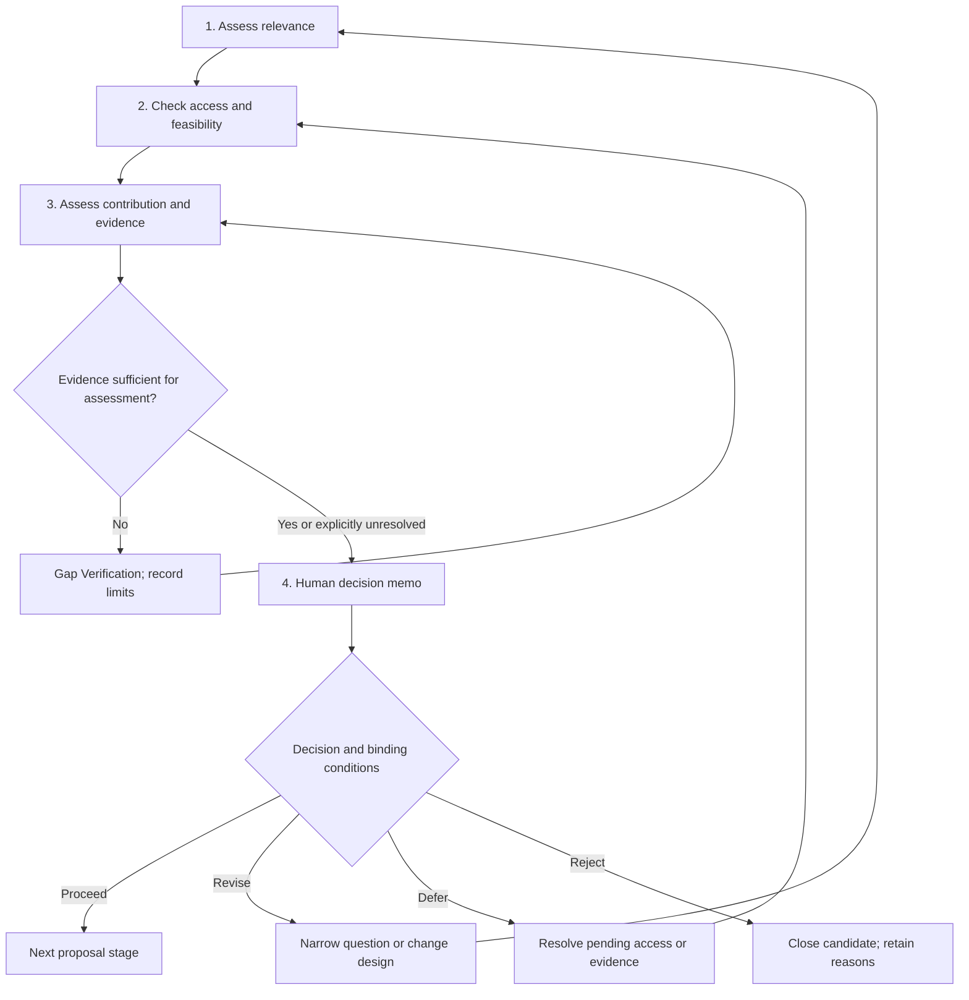

# Topic Validation

`WF-02` · Version 2.0.0 · 2026-10-31 · [English / فارسی](topic-validation.fa.md)

## Objective and prerequisites

Decide whether a candidate deserves a proposal, revision, deferral, or rejection. Evaluate relevance, practical access, methodological fit, and the nature of the proposed contribution separately. A promising topic can still be infeasible. A low-resource interpretive project can still make a substantial contribution. Start with a candidate question and a researcher willing to verify access claims; no numerical rubric is mandatory.

## Inputs

Required: candidate question/title, discipline and intended academic output, known deadline, and what is actually accessible. Unknown access is acceptable but cannot count as confirmed. Optional: degree regulations, a literature inventory, budget, skills, ethics constraints, equipment, language competence, and supervisor feedback. `[TOPIC]` is the candidate record; `[CONSTRAINTS]` lists these concrete limits.

## Stages and decisions

Insufficient evidence may lead to deferral, not endless searching. A fatal permission or safety constraint cannot be cancelled by a favorable score.

## Step-by-step process

| Stage | Copyable instruction | Output and verification |
|---|---|---|
| 1. Relevance | “Assess [TOPIC] against the stated academic purpose and intended audience. Explain whose problem or interpretive question it addresses. Distinguish personal interest, practical importance, and scholarly relevance. Ask up to three critical questions if these are unclear.” | A relevance statement. A researcher or supervisor checks whether the framing fits the discipline. |
| 2. Access and feasibility | Use [Feasibility Assessor](../prompts/feasibility-assessor.md). “Assess [TOPIC] under [CONSTRAINTS]. Separate confirmed resources, unconfirmed assumptions, and unavailable requirements. Produce a minimum viable study, dependencies, timeline with contingency, and explicit stop conditions. Treat ethics clearance and permission as prerequisites where required.” | Resource register and a realistic sequence. Confirm access with the data custodian, archive, lab, or institution; model assertions are not confirmation. |
| 3. Contribution | Use [Gap Hypothesis](../prompts/gap-hypothesis.md) only for tentative directions. “Explain the proposed contribution without calling it novel. Is it replication, extension, interpretation, method, theory, source edition, or synthesis? Identify the closest work from supplied verified sources and the strongest challenge to the contribution. State what literature review is still needed.” | Contribution hypothesis and disconfirming search plan. If no verified sources exist, mark evidence insufficient and use [Gap Verification](gap-verification.md). |
| 4. Decision | Use [Topic Critic](../prompts/topic-critic.md). “Write a decision memo for [TOPIC]. Choose proceed, revise, defer, or reject. Explain binding constraints separately from preferences. List conditions that must be met and who can verify each. Do not let a high average score override a fatal permission or safety issue.” | Human-approved decision and action list. Update the title with [Title Refiner](../prompts/title-refiner.md) if scope changes. |

## Decision rules and error handling

Proceed means ready for the next proposal stage, not guaranteed acceptance. Revise when a narrower scope or different design can address the main problem. Defer when a necessary decision, permission, or source is pending. Reject when essential access is unavailable or the design cannot answer the question. Do not equate “not immediately feasible” with “worthless.”

When budget or timing is missing, request a range instead of inventing exact costs. When a causal claim lacks identification, propose an associational/descriptive question or require a defensible design. When original languages or textual traditions matter, include relevant competence and editions as dependencies. For life sciences, institutional approval and qualified supervision govern sensitive work; the model does not authorize experiments.

## Worked example — illustrative decision record

Candidate: “Does a new dashboard increase decision quality in a manufacturing company?” Researcher: management Master's student; twelve weeks; only anonymized usage logs confirmed; neither employee outcome access nor intervention permission. Relevance is plausible, but the proposed causal outcome is not observable in the supplied resources. Contribution is unverified because no documented literature search has occurred.

Decision: revise. Proposed question: “How do dashboard-use patterns vary across authorized business units over the observation period?” Minimum viable study: data dictionary and permission check in week 1; completeness/identifier checks in week 2; descriptive analysis and sensitivity to activity definitions in weeks 3–6; interpretation with authorized domain review in weeks 7–8; writing and contingency in weeks 9–12. This is a planning illustration, not a validated schedule or actual company finding. Stop if de-identification fails or unit comparisons permit employee identification. Next steps: confirm aggregation permissions with the custodian, search dashboard-adoption literature, and ask the supervisor whether descriptive scope meets degree expectations.

## Final output contract

Return: candidate and revised question if needed; relevance rationale; contribution type and evidence status; resource/permission register with owners; design-to-question fit; timeline and contingency; critical risks and mitigations; decision and conditions; unresolved uncertainties; next verification action and responsible person. Avoid an overall numerical score unless its local meaning is agreed. If used, report dimension scores and veto conditions alongside it.

## Optional tools and integrity safeguards

A document and checklist suffice. A spreadsheet may track dependencies and owners; a citation manager can attach verified neighboring work. Do not represent a tool's availability as permission to use data. Minimize uploads, de-identify where justified, respect licenses and archival restrictions, and disclose AI assistance under applicable policies. Researchers verify feasibility with responsible humans and retain the reasons for rejected alternatives.
